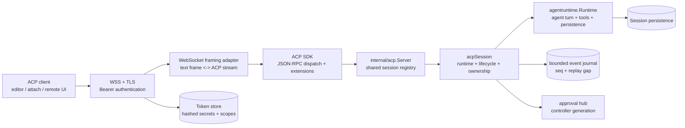
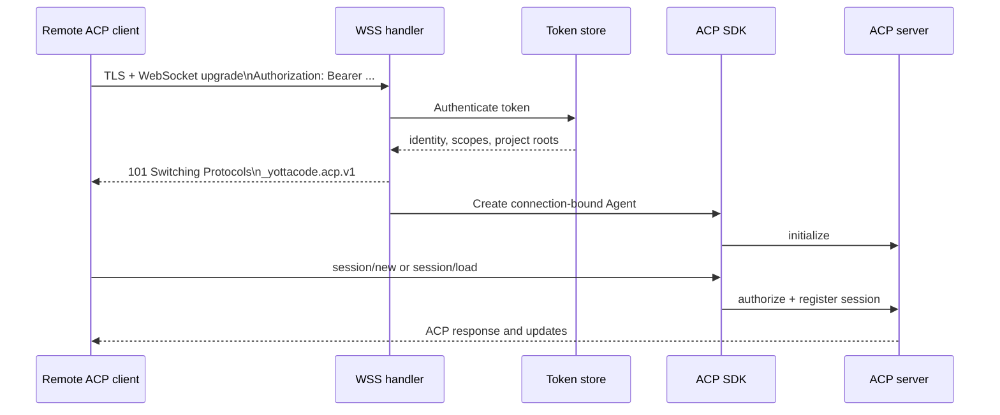
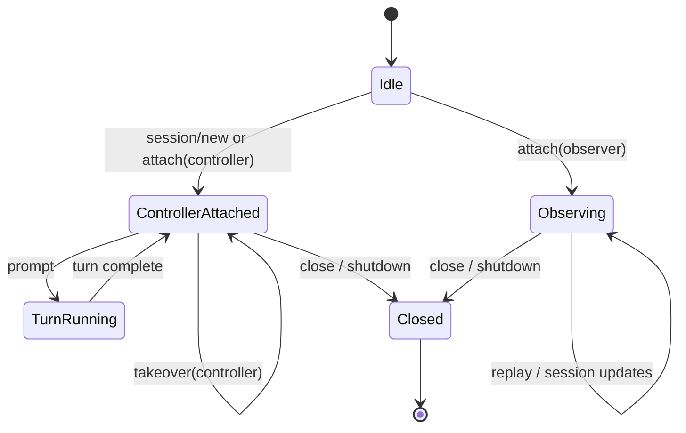

# ACP remote-session architecture

This document describes the experimental ACP-over-WSS architecture and the
session ownership model. It is intentionally more detailed than the user-facing
CLI reference because it defines protocol boundaries and invariants.

## Scope

`yottacode acp` supports two transports:

- stdio for local editor embedding;
- WSS for authenticated remote ACP clients.

Both transports use the ACP SDK for protocol semantics. WSS adds a narrow
WebSocket framing adapter; it does not replace ACP JSON-RPC dispatch.

## Components

## Connection lifecycle

Authentication happens before ACP initialization. An unauthenticated client
must never reach `initialize`, `session/load`, or an extension method.

## Ownership model

Each live session has:

- one optional controller;
- zero or more observers;
- one agent runtime;
- one lifecycle lock that serializes prompt, replacement, and close.

Controller-only operations:

- prompt;
- cancel;
- close;
- session mode/configuration changes;
- permission decisions.

Observer operations:

- attach;
- replay;
- receive future updates.

Takeover must be explicit and requires `prompt` or `admin` scope. A normal
controller attach fails when another controller owns the session.

## Extension methods

ACP extension methods must begin with `_` according to the SDK and ACP
extensibility rules. Current names are:

| Method | Role | Purpose |
|---|---|---|
| `_yottacode/session/attach` | read/control | Attach as observer or controller |
| `_yottacode/session/replay` | read | Replay conversational history |
| `_yottacode/session/takeover` | control | Explicitly replace controller |

The extensions are yottacode-specific and are not a replacement for standard
ACP `session/new`, `session/load`, `session/prompt`, or `session/cancel`.

## Security invariants

- WSS requires TLS and bearer authentication.
- Raw bearer tokens are displayed once and never persisted.
- Token files are user-only (`0700` directory, `0600` file).
- Authentication uses constant-time comparison after salted hashing.
- Scopes are checked at ACP method dispatch, not only during WebSocket upgrade.
- Project-root restrictions are checked for session creation, loading, and attach.
- Session IDs do not grant access by themselves.
- A client disconnect does not implicitly approve a pending permission request.

## Current limitations

The implementation remains experimental. Implemented hardening now includes
bounded in-memory event cursors, replay-gap signaling, controller generations,
parked permission requests, WSS server timeouts, and attach role/takeover flags.
Durable event storage across daemon restarts, connection registries, rate
limiting, daemon start/stop/status commands, and full reconnect backoff remain
operational follow-up work.
