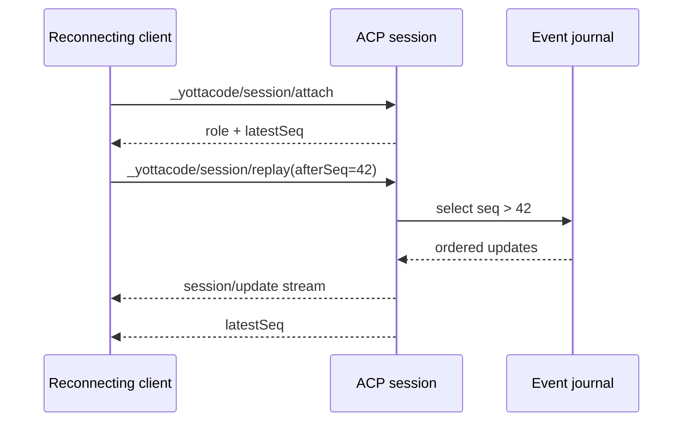

## Event sequencing and reconnect

Every live ACP session maintains a bounded in-memory event journal. Each
controller/observer session update receives a monotonically increasing
`seq` value internally. The journal is capped at 2,048 updates to prevent a
slow or abandoned client from growing daemon memory without bound.

A reconnecting client first attaches, then requests:

```json
{
  "sessionId": "...",
  "afterSeq": 42
}
```

The server replays journal entries with sequence numbers greater than `42`
and returns the latest sequence. The current implementation also retains the
persisted conversational transcript as the fallback when no cursor is given.



The journal is deliberately an in-memory delivery/reconnect layer, not the
source of truth for agent history. Durable session persistence remains the
source of truth for transcript recovery. Future hardening will add an explicit
`replay_gap` response when the requested cursor predates the bounded journal,
followed by a transcript snapshot and a live-update handoff.
