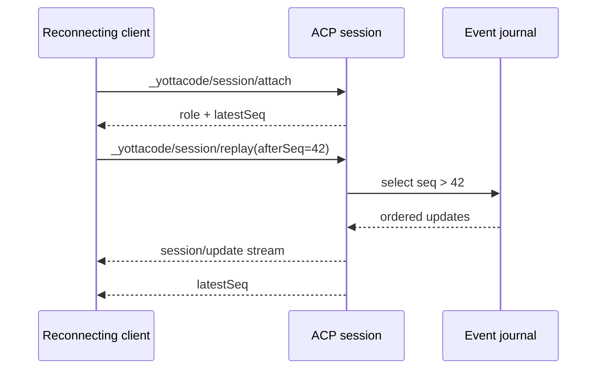

## Event sequencing and reconnect

Every live ACP session maintains a bounded in-memory event journal. Each
controller/observer session update receives a monotonically increasing
`seq` value internally. The journal is capped at 2,048 updates to prevent a
slow or abandoned client from growing daemon memory without bound.

A reconnecting client first attaches, then requests:

```json
{
  "sessionId": "...",
  "afterSeq": 42
}
```

The server replays journal entries with sequence numbers greater than `42`
and returns the latest sequence. The current implementation also retains the
persisted conversational transcript as the fallback when no cursor is given.



The journal is a bounded persisted delivery/reconnect layer, not the source
of truth for agent history. Journal sequence continuity is restored when a
session is loaded after restart, and append failures fall back to a local
sequence while remaining visible to future durability diagnostics. Durable session persistence remains the
source of truth for transcript recovery. If the cursor predates the bounded
journal, the extension returns an error identifying that a replay gap requires
a snapshot. The client can then issue standard `session/load` to recover the
persisted transcript before resuming live updates.

Controller takeover increments an internal ownership generation. Pending
permission requests are parked in the session and routed to the current
controller; a disconnected controller cannot silently approve a request after
takeover.
